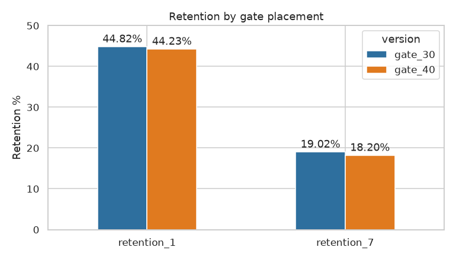
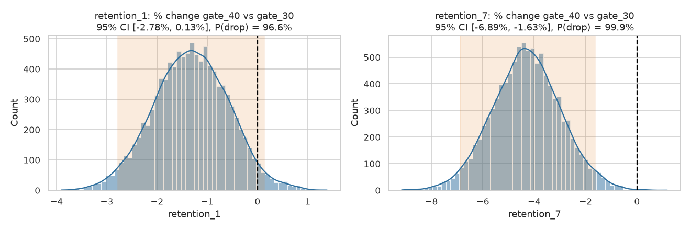
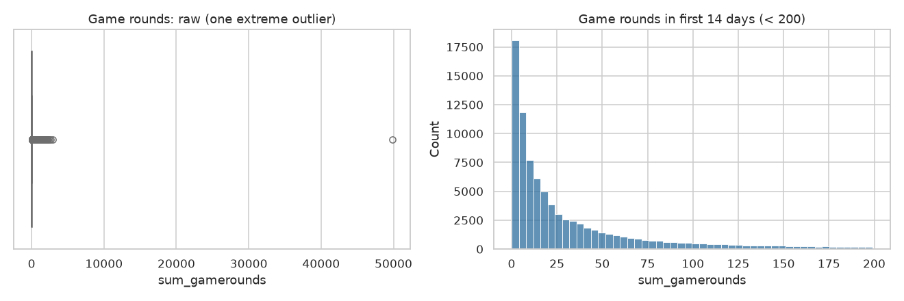

# A/B Test Analysis: Mobile Game Retention (Cookie Cats)

Did moving the first "gate" in the mobile puzzle game *Cookie Cats* from **level 30 to level 40** change player retention? This project analyses a randomised A/B test of **90,189 players** with hypothesis testing, bootstrapping and a power check, and ends with a product recommendation.

**Notebook:** [`ab_test_analysis.ipynb`](ab_test_analysis.ipynb)

## Result

| Metric | gate_30 (control) | gate_40 (treatment) | Difference | 95% CI | p-value | Significant? |
|---|---|---|---|---|---|---|
| **1-day retention** | 44.82% | 44.23% | −0.59 pp (−1.3%) | [−1.24, +0.06] pp | 0.074 | No |
| **7-day retention** | 19.02% | 18.20% | **−0.82 pp (−4.3%)** | [−1.33, −0.31] pp | **0.0016** | **Yes** |

- Bootstrap (10,000 resamples): gate_40 lowers 7-day retention in **>99%** of resamples (95% CI for the relative change: −6.9% to −1.6%).
- Engagement: median rounds played 17 vs 16 (Mann-Whitney p = 0.051, not significant).
- Power: the test had **~97% power** to detect a 1 pp drop in 7-day retention, so it was well powered for the effect it found.

### Recommendation: **keep the gate at level 30.**
Moving the gate to level 40 causes a statistically significant **4.3% relative drop in 7-day retention**, the metric most closely tied to long-term revenue. A likely explanation is *hedonic adaptation*: an earlier break keeps the game feeling fresh, while a later gate lets players burn out before they get one.




## Method
1. **Data checks:** no missing values or duplicate users. Removed one extreme outlier (49,854 rounds in 14 days, likely a bot or logging error).
2. **Sample Ratio Mismatch check:** the split is 49.56% / 50.44% (χ² p = 0.0085). The imbalance is statistically detectable but very small, so it is noted as a caveat and the analysis proceeds.
3. **Hypothesis tests:** two-proportion z-test and chi-square test of independence for each retention metric (two-sided, α = 0.05). Both tests agree.
4. **Bootstrap confidence intervals** as a non-parametric check on the z-test.
5. **Mann-Whitney U test** for engagement (game rounds are heavily skewed, so a t-test is inappropriate).
6. **Power analysis** (statsmodels) to show which effect sizes the test could reliably detect.



## Run it
```bash
pip install -r requirements.txt
./download_data.sh
jupyter notebook ab_test_analysis.ipynb
```
